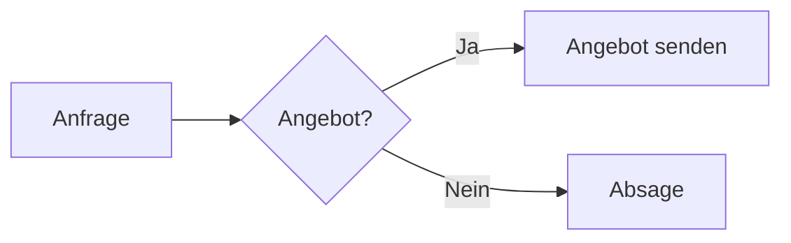

# Anleitung Wissensmanagement

> [!info] Worum geht es?
> Das Wissensmanagement ist unser eigenes „Notion in Odoo“: ein Wiki für alles, was wir wissen. Dazu gehören Prozesse, Kundenwissen, Projektnotizen, Protokolle und Vorlagen.
> Alles passiert direkt in Odoo: Seiten schreiben, Kontakte, Projekte, Aufgaben oder Angebote erwähnen, Aufgaben anlegen, im Chatter teilen. Gespeichert wird im Wissensordner auf dem Odoo-Server.

## Kurzfassung: Das reicht für den Alltag

| Ich will … | So geht’s |
|---|---|
| **Eine Seite finden** | Links im Baum klicken oder `/` drücken und suchen |
| **Etwas schreiben** | Oben rechts **Schreiben** (oder `Strg+E`), dann einfach lostippen wie in Word. Speichert automatisch. |
| **Etwas einfügen** (Tabelle, Liste, Box, Spalten …) | `/` tippen und auswählen |
| **Eine andere Seite verlinken** | `[[` tippen und die Seite wählen |
| **Kunde, Projekt, Aufgabe, Angebot, Post … erwähnen** | `@` tippen, Bereich wählen, Namen tippen. Es erscheint eine Live-Karte aus Odoo. |
| **Mit anderen gleichzeitig schreiben** | Einfach machen: Alle sehen die Änderungen sofort, mit farbigem Cursor und Namen |
| **Eine neue Seite anlegen** | **+ Neue Seite** oben links, optional mit Vorlage |
| **Eine Odoo-Aufgabe aus einer Checkliste machen** | Lesemodus, Maus auf den Punkt, **☑ Aufgabe** |
| **Etwas rückgängig machen** | `Strg+Z` beim Schreiben, ältere Stände über 🕘 Versionsverlauf, gelöschte Seiten über 🗑 Papierkorb |
| **Eine Frage zu einer Stelle stellen** | Text markieren, **Kommentieren** |

> [!tip] Drei Regeln, dann passt alles
> 1. **Mit @ erwähnen** statt Namen nur zu tippen, dann bleibt alles mit Odoo verbunden.
> 2. **Verlinken statt kopieren:** Steht etwas schon woanders, mit `[[` verlinken.
> 3. **Jede Seite beginnt mit 1–2 Sätzen:** Worum geht es, für wen ist das?

Alles Weitere steht unten im Detail. Niemand muss das alles auswendig wissen: `/` und `@` zeigen immer an, was möglich ist.

---

## 1. Das Grundprinzip in 30 Sekunden

- Jede **Seite** ist eine Datei, z. B. `Kunden.md`.
- Seiten können **Unterseiten** haben, so entsteht ein Seitenbaum wie in Notion.
- Man **liest** schön formatiert und **schreibt** wie in Word. Markdown-Kenntnisse braucht niemand.
- Seiten lassen sich untereinander **verlinken** und mit **@ an Odoo anbinden** (Kontakte, Projekte, Aufgaben …).
- Odoo merkt sich, **wer zuletzt bearbeitet hat**, speichert **Versionen** und erlaubt **Kommentare**.

---

## 2. Rollen: Wer darf was?

| Rolle | Darf |
|---|---|
| **Leser** | Alle (freigegebenen) Seiten lesen, suchen, kommentieren, Favoriten setzen |
| **Bearbeiter** | Zusätzlich: Seiten anlegen, schreiben, verschieben, umbenennen, duplizieren, löschen und aus dem Papierkorb wiederherstellen, freigeben |
| **Administrator** | Zusätzlich: Einstellungen (Wissensordner, Stil, erwähnbare Bereiche), Ordnerrechte, Papierkorb leeren |

Die Rolle wird in Odoo unter *Einstellungen › Benutzer › Wissensmanagement* vergeben.

> [!tip] Bestimmte Bereiche nur für bestimmte Teams
> Über **Ordnerrechte** lässt sich z. B. der Bereich „Vertrieb“ nur für das Vertriebsteam sichtbar machen. Siehe Kapitel 16.

---

## 3. Die Oberfläche

```
┌──────────────┬──────────────────────────────────────┬──────────────┐
│ Seitenleiste │ Seite                                │ Rechte Leiste│
│              │                                      │              │
│ 🔍 Suche     │ Pfad / Pfad / Seitenname  ⭐   👥 💬 🕘 🔗 ⋯ │ Lesen|Schreiben │
│ + Neue Seite │──────────────────────────────────────│ Gliederung   │
│ ⭐ Favoriten  │ Titel                                │ Verlinkt von │
│ 🕘 Zuletzt    │ Zuletzt bearbeitet von @Person …     │ Kommentare   │
│ 📄 Seiten     │ Inhalt …                             │              │
└──────────────┴──────────────────────────────────────┴──────────────┘
```

| Element | Funktion |
|---|---|
| **Suche** (Taste `/`) | Volltextsuche über alle Seiten |
| **Neue Seite** / 📁 | Seite bzw. Ordner auf oberster Ebene anlegen |
| **Favoriten** | Deine mit ⭐ markierten Seiten (persönlich) |
| **Zuletzt bearbeitet** | Die zuletzt geänderten Seiten (für alle gleich) |
| **Seiten** | Der Seitenbaum zum Durchklicken |
| 🗺 (oben in der Seitenleiste) | Übersicht: Graph, Tags, verwaiste Seiten, kaputte Links |
| 🗑 (oben in der Seitenleiste) | Papierkorb: gelöschte Seiten wiederherstellen |
| ⭐ neben dem Seitennamen | Seite zu Favoriten hinzufügen |
| 👥 Avatare | Wer gerade auf der Seite ist (✏️ = schreibt gerade mit) |
| 💬 | Kommentare |
| 🕘 | Versionsverlauf |
| 🔗 / 🌐 | Freigeben (🌐 = Seite ist freigegeben) |
| ⋯ | Weitere Aktionen (Unterseite, Umbenennen, Verschieben, Duplizieren, Drucken, Löschen …) |
| **Lesen / Schreiben** | Umschalter oben rechts (Tastenkürzel `Strg+E`) |
| Rechte Leiste | Gliederung (Inhaltsverzeichnis der Seite), Rückverweise, Kommentare |

---

## 4. Seiten, Unterseiten und Ordner

Das ist der wichtigste Unterschied im ganzen System.

### Die drei Arten von Einträgen

| | 📄 **Seite** | 📑 **Seite mit Unterseiten** | 📁 **Ordner** |
|---|---|---|---|
| Hat eigenen Inhalt? | ✅ ja | ✅ ja | ❌ nein |
| Hat Unterseiten? | nein | ✅ ja | ✅ ja |
| Beim Anklicken | Text der Seite | Text der Seite, darunter Karten aller Unterseiten | Nur Karten der Inhalte |
| Favorit, Kommentare, Versionen, Freigabe, Verlinkung | ✅ | ✅ | ❌ |
| Auf der Festplatte | `Kunden.md` | `Kunden.md` **und** Ordner `Kunden/` | nur Ordner `Kunden/` |

**Eine Unterseite ist einfach eine Seite, die „unter“ einer anderen hängt.** Technisch liegt sie in einem Ordner mit dem gleichen Namen wie die Elternseite:

```
Kunden.md                  ← Seite „Kunden“ (mit eigenem Text)
Kunden/
  Müller GmbH.md           ← Unterseite
  Müller GmbH/
    Gesprächsnotiz.md      ← Unter-Unterseite
```

Ein **Ordner** ist derselbe Behälter, nur **ohne** eigene Seite, also eine reine Sortierhilfe.

### Wann nehmen wir was?

| Situation | Unsere Wahl | Beispiel |
|---|---|---|
| Der übergeordnete Punkt hat selbst etwas zu sagen (Überblick, Regeln, Links, Ansprechpartner) | **Seite mit Unterseiten** ✅ *Standard* | „Kunden“ mit Übersichtstabelle, darunter je Kunde eine Seite |
| Es geht nur ums Sortieren, ohne Text | **Ordner** | „Anhänge“, „Archiv 2024“ |
| Einzelnes Thema | **Seite** | „Urlaubsregelung“ |

> [!important] Unsere Regel
> **Im Zweifel immer „Seite mit Unterseiten“.** Ein Ordner hat keine Beschreibung, keine Kommentare, keine Versionen und kann nicht verlinkt werden. Eine Seite kann das alles, und ein kurzer Einleitungssatz hilft jedem, der neu dazukommt.

### Umwandeln
- **Ordner → Seite mit Unterseiten:** Ordner anklicken und „Erste Seite in diesem Ordner anlegen“ wählen. Alternativ neben dem Ordner eine Seite mit **exakt gleichem Namen** anlegen.
- **Seite → Seite mit Unterseiten:** Einfach eine Unterseite anlegen (⋯ › *Unterseite anlegen* oder ➕ im Baum). Der Ordner entsteht automatisch.

---

## 5. Seiten anlegen

1. **+ Neue Seite** (oben links), ➕ neben einem Eintrag im Baum oder ⋯ › *Unterseite anlegen*.
2. **Titel** eingeben.
3. **Ablegen unter** wählen (oberste Ebene, eine Seite oder ein Ordner).
4. **Vorlage verwenden?** Leere Seite oder eine Vorlage anklicken (Doppelklick legt sofort an).
5. **Seite anlegen**: Die Seite öffnet sich direkt im Schreibmodus.

> [!tip] Seite aus einem Link anlegen
> Ein Link auf eine Seite, die es noch nicht gibt, erscheint **grau gestrichelt mit ➕**. Ein Klick darauf legt die Seite direkt an.

### Erlaubte Namen
Nicht erlaubt sind `\ / : * ? " < > | # ^ [ ]` und ein Punkt am Anfang. Gibt es den Namen schon, hängt Odoo automatisch „ 1“, „ 2“ … an.

---

## 6. Vorlagen

Alle Seiten im Bereich **„Vorlagen“** werden beim Anlegen einer Seite automatisch angeboten.

### Vorlage erstellen oder bearbeiten
Einfach eine ganz normale Seite unter „Vorlagen“ anlegen oder bearbeiten. Hat eine Vorlage **Unterseiten**, werden diese beim Anlegen mitkopiert. So entsteht z. B. ein komplettes Projekt mit „Kickoff“, „Protokolle“ und „Abschluss“ auf einen Klick.

### Platzhalter
| Platzhalter | Wird ersetzt durch | Beispiel |
|---|---|---|
| `{{title}}` | Titel der neuen Seite | „Kickoff Müller“ |
| `{{date}}` | Heutiges Datum | 2026-10-15 |
| `{{date:DD.MM.YYYY}}` | Datum im gewünschten Format | 15.10.2026 |
| `{{time}}` | Uhrzeit | 14:30 |

Formate für das Datum: `YYYY` Jahr, `MM` Monat, `DD` Tag, `HH` Stunde, `mm` Minute, `dddd` Wochentag.

### Vorlage in bestehende Seite einfügen
Im Schreibmodus `/vorlage` tippen und die gewünschte Vorlage wählen.

### Unsere Standard-Vorlagen (Vorschlag)
- **Meeting**: Datum, Teilnehmer, Agenda, Beschlüsse, Aufgaben
- **Kunde**: Firma, Ansprechpartner, Historie, offene Punkte
- **Projekt**: Ziel, Beteiligte, Meilensteine, Risiken (mit Unterseiten)
- **Prozess**: Zweck, Ablauf (Diagramm), Verantwortliche, Checkliste

---

## 7. Lesen und Schreiben

Oben rechts gibt es den Umschalter **Lesen | Schreiben** (`Strg+E`).

### Lesemodus
- Schön formatierter Text mit Links, Karten und Diagrammen
- **Checkboxen kann man direkt anklicken**, die Änderung wird sofort gespeichert
- Text markieren und **Kommentieren** wählen, um zu dieser Stelle einen Kommentar zu schreiben

### Schreibmodus (wie Word)
Man schreibt einfach los. Die Symbolleiste bietet:

| Symbol | Funktion |
|---|---|
| **H** | Überschrift 1–6 |
| **B** / *I* | Fett / Kursiv |
| • / 1. / ☑ | Aufzählung / Nummerierung / Checkliste |
| 📖 | Link zu einer anderen Wissensseite |
| @ | Odoo-Datensatz erwähnen |
| 🖼 | Bild oder Datei einfügen |
| ⓘ | Hinweisbox |
| ≡ (zentriert) | Absatz zentrieren (an/aus) |
| ▥ | Spalten nebeneinander |
| ▦ | Tabelle (Zeilen/Spalten per Rechtsklick) |
| ❝ / — | Zitat / Trennlinie |
| 🔗 | Link zu einer Webseite |
| ⋯ | Seltenes: Durchgestrichen, Code, Code-Block (je nach Fensterbreite rutschen Knöpfe hierhin) |

- **Speichert automatisch** (oben steht „Gespeichert“ oder „Ungespeichert“). `Strg+S` speichert sofort.
- Bilder lassen sich auch einfach **einfügen** (`Strg+V`) oder **hineinziehen**.
- Für Profis: Unten rechts zeigt „Markdown-Quelltext anzeigen“ den Rohtext (gesperrt, solange andere live mitschreiben).

### Chips anpassen: Klick oder Rechtsklick
Seitenlinks, @-Erwähnungen, Hinweisboxen, Spalten und zentrierte Bereiche erscheinen im Editor als farbige **Chips** (kleine Etiketten). Ein Klick (oder Rechtsklick) auf einen Chip öffnet ein Menü. Codes muss sich niemand merken.

| Chip | Im Menü einstellbar |
|---|---|
| **Hinweisbox** (z. B. `TIPP`) | Art: Notiz, Info, Tipp, Wichtig, Erledigt, Frage, Warnung, Achtung, Beispiel, Zitat, To-do · Darstellung: immer offen, einklappbar oder eingeklappt · Box entfernen |
| **Seitenlink** | Zielseite (mit Suche), Abschnitt der Seite (Auswahlliste), angezeigter Text, „Inhalt einbetten statt verlinken“, Öffnen, Link entfernen |
| **Bild** | Breite in Pixeln |
| **@-Erwähnung** | Datensatz öffnen, anderen Datensatz wählen, nur Text behalten |
| **Spalten** | Aufteilung, Spalte hinzufügen, Spalten auflösen |
| **Spalte** (einzeln) | Diese Spalte entfernen |
| **Zentriert** | Zentrierung aufheben |

`Esc` oder ein Klick daneben schließt das Menü.

> [!note] Quelltext
> „Markdown-Quelltext anzeigen“ (unten rechts) zeigt die Seite so, wie sie in der Datei steht, z. B. `> [!tip]-` oder `[[Prozess#Ablauf]]`. Dort kann man auch direkt tippen; zurück geht es mit „Zurück zur normalen Ansicht“.

### Slash-Befehle `/`
Am Zeilenanfang (oder nach einem Leerzeichen) `/` tippen, dann öffnet sich ein Menü. Weitertippen filtert es, `Enter` fügt ein.

| Befehl | Fügt ein |
|---|---|
| `/h1` `/h2` `/h3` | Überschrift |
| `/liste` · `/nummer` · `/checkliste` | Aufzählung · Nummerierte Liste · Checkliste |
| `/tabelle` | Tabelle 3×3 |
| `/trennlinie` | Trennlinie (Abschnitt) |
| `/zitat` | Zitat |
| `/hinweis` | Hinweisbox |
| `/2 spalten` · `/3 spalten` | Inhalte nebeneinander |
| `/zentriert` | Absatz zentrieren (an/aus) |
| `/code` | Code-Block |
| `/diagramm` | Mermaid-Diagramm (Flussdiagramm) |
| `/seite` | Link zu Wissensseite |
| `/erwähnen` | @-Erwähnung |
| `/aufgabe` | Aufgabe erwähnen **oder** neue Odoo-Aufgabe anlegen |
| `/post` | Social-Media-Post erwähnen (wenn Social Media installiert ist) |
| `/vorlage` | Inhalt einer Vorlage einfügen |
| `/bild` | Bild / Datei hochladen |
| `/datum` | Heutiges Datum |

### Tastenkürzel
| Kürzel | Funktion |
|---|---|
| `Strg+E` | Lesen ⇄ Schreiben |
| `Strg+S` | Speichern |
| `Strg+B` / `Strg+I` | Fett / Kursiv |
| `/` (im Lesemodus) | Suche öffnen |
| `/` (im Editor) | Slash-Menü |
| `[[` | Wissensseite verlinken |
| `@` | Odoo-Datensatz erwähnen |
| `↑ ↓ Enter Esc` | Im Vorschlags-Menü navigieren |

---

## 8. Seiten verlinken

Im Editor `[[` tippen und die Seite auswählen, oder den 📖-Knopf nutzen.

| Schreibweise | Bedeutung |
|---|---|
| `[[Müller GmbH]]` | Link auf die Seite |
| `[[Müller GmbH\|unser Großkunde]]` | Link mit eigenem Text |
| `[[Prozess#Ablauf]]` | Link direkt auf einen Abschnitt |
| `![[Gesprächsnotiz]]` | Seite **einbetten** (Inhalt wird angezeigt) |
| `![[logo.png\|200]]` | Bild einbetten, 200 px breit |

- Links zu anderen Wissensseiten sind **farbig hervorgehoben** (lila mit 📄-Symbol), externe Links normal.
- Links auf **nicht existierende** Seiten erscheinen grau gestrichelt. Ein Klick legt die Seite an.
- **Umbenennen oder Verschieben passt alle Links automatisch an.**
- Rechts unter **„Verlinkt von“** steht, welche Seiten auf die aktuelle Seite zeigen.

---

## 9. @-Erwähnungen: die Verbindung zu Odoo

Mit `@` bindet man Odoo-Datensätze in den Text ein. Sie zeigen **immer den aktuellen Stand** (Phase, Zuständige, Deadline …) und sind anklickbar.

### So geht’s
**Weg 1: Bereich wählen**
1. Im Editor nur `@` tippen. Es öffnet sich ein Menü mit allen Bereichen (Kontakte, Projekte, Aufgaben …).
2. Bereich mit Maus oder Pfeiltasten + `Enter` wählen, z. B. **@aufgabe**.
3. Es erscheinen sofort die Aufgaben. Weitertippen filtert, `Enter` fügt die Erwähnung ein.

**Weg 2: direkt den Namen tippen**
1. `@` und gleich den Namen tippen, z. B. `@cl`.
2. Odoo schlägt passende Einträge aus allen Bereichen vor, z. B. **Claude Bot**, mit Bild und Typ. Passt der Text zu einem Bereich (z. B. `@auf`), steht dieser Bereich oben in der Liste.
3. Mit `Enter` auswählen, fertig.

### Gezielt suchen mit Kürzeln
Steht ein Kürzel direkt hinter dem `@`, wird **nur in diesem Bereich** gesucht. Beispiel: `@aufgabe bank` findet nur Aufgaben mit „bank“.

| Kürzel | Sucht in | Beispiel |
|---|---|---|
| @kontakt · @kunde · @firma · @person | Kontakte | @kontakt müller |
| @benutzer · @user | Odoo-Benutzer (Kolleginnen und Kollegen) | @benutzer anna |
| @projekt | Projekte | @projekt website |
| @aufgabe · @task | Aufgaben | @aufgabe bank |
| @angebot · @auftrag · @verkauf | Angebote & Verkaufsaufträge | @angebot S00042 |
| @lead · @chance · @opportunity | CRM-Leads & Verkaufschancen | @lead messe |
| @einkauf · @bestellung | Einkaufsbestellungen | @einkauf P00017 |
| @rechnung · @beleg | Rechnungen & Belege | @rechnung 2026/0815 |
| @produkt · @artikel | Produkte | @produkt beratung |
| @mitarbeiter | Mitarbeiter | @mitarbeiter max |
| @ticket | Helpdesk-Tickets | @ticket login |
| @termin | Kalender-Termine | @termin kickoff |
| @lieferung | Lieferungen | @lieferung WH/OUT |
| @fertigung | Fertigungsaufträge | @fertigung MO/0012 |
| @reparatur | Reparaturen | @reparatur pumpe |
| @gerät | Geräte (Wartung) | @gerät drucker |
| @posts · @post · @beitrag · @social | Social-Media-Posts (gesucht wird im Post-Text) | @posts sommeraktion |
| @kanal · @konto | Social-Media-Konten | @kanal instagram |

> [!note] Nicht alle Bereiche sind immer aktiv
> Erwähnbar ist nur, was in unserem Odoo installiert und in den Einstellungen freigeschaltet ist (*Wissensmanagement › Konfiguration › Einstellungen › Erwähnbare Odoo-Modelle*). Man sieht außerdem nur Datensätze, auf die man in Odoo selbst Zugriff hat.

### Chip oder große Karte?
| Schreibweise | Darstellung |
|---|---|
| Erwähnung **im Fließtext**: „Die Recherche macht @Claude Bot im Projekt @Website“ | **Chip** mit Bild und Phase. Maus darüber zeigt die Vorschaukarte. |
| Erwähnung **allein in einer Zeile** | **Große Vorschaukarte** mit Phase, Priorität ⭐, Zuständigen, Tags, Deadline, Betrag … |

Ein Klick auf Chip oder Karte öffnet den Datensatz in Odoo. Über den Zurück-Pfad oben kommt man wieder zur Seite.

**Was die Karte zeigt (je nach Bereich):**
- **Aufgabe:** Projekt, Phase, Status, Tags, Deadline (rot wenn überfällig), Priorität, Zuständige
- **Projekt:** Kunde, Phase, Status, Verantwortlicher
- **Kontakt:** Firma, E-Mail, Telefon, Tags, Bild/Logo
- **Angebot / Rechnung:** Kunde, Status, Betrag, Datum / Fälligkeit
- **Lead:** Phase, erwarteter Umsatz, Kunde, Priorität
- **Social-Media-Post:** erste Zeile des Texts, Kanäle (z. B. Instagram, LinkedIn), Status, geplant bzw. veröffentlicht am
- **Social-Media-Konto:** Plattform und Name des Kanals

Durchgestrichene Erwähnungen 🔗 zeigen auf einen gelöschten Datensatz.

### Rückrichtung: „Wo wird das erwähnt?“
In **jedem** Odoo-Formular (Kontakt, Aufgabe, Projekt, Angebot …) erscheint oben ein Knopf **📖 Wissen (n)**, sobald der Datensatz auf Wissensseiten erwähnt wird. Ein Klick listet alle Seiten auf.

---

## 10. Aufgaben direkt aus Checklisten

1. Eine Checkliste schreiben (`/checkliste`).
2. Im Lesemodus mit der Maus über einen Punkt fahren, dann erscheint **☑ Aufgabe**.
3. Projekt wählen, optional „Mir zuweisen“ und eine Deadline setzen, dann **Aufgabe anlegen**.
4. Die Aufgabe wird in Odoo angelegt und **hinter der Checkbox als Live-Erwähnung verlinkt**.

Alternativ legt `/aufgabe` › *Neue Odoo-Aufgabe anlegen* direkt beim Schreiben eine Aufgabe an.

---

## 11. Inhalte gestalten

### Hinweisboxen
Mit `/hinweis` oder dem ⓘ-Knopf. Den Typ ändert ein Klick auf das Etikett oben in der Box:

| Typ | Farbe | Wofür |
|---|---|---|
| Notiz / Info | Blau | Allgemeine Hinweise |
| Tipp | Grün | Tipps & Tricks |
| Wichtig | Blau | Wichtiges |
| Erledigt | Grün | Abgeschlossenes |
| Frage | Orange | Offene Fragen |
| Warnung | Orange | Achtung / Risiko |
| Achtung | Rot | Kritisch, nicht machen! |
| Beispiel | Lila | Beispiele |
| Zitat | Grau | Zitate |
| To-do | Türkis | To-dos |

Im selben Menü lässt sich die Box **zuklappen** oder wieder entfernen.

### Spalten (Inhalte nebeneinander)
Mit dem Spalten-Knopf (▥) in der Werkzeugleiste oder `/2 spalten` bzw. `/3 spalten` entsteht ein Bereich mit
Spalten nebeneinander. In jede Spalte schreibt man ganz normal: Text, Überschriften, Listen, Bilder, @-Erwähnungen.

Ein **Klick auf das Spalten-Etikett** oben im Bereich öffnet das Menü:

| Menüpunkt | Wirkung |
|---|---|
| Aufteilung | Gleich breit, Schmal \| Breit (1:2), Breit \| Schmal (2:1) oder Seitenleiste \| Inhalt (1:3) |
| Spalte hinzufügen | Neue Spalte rechts anfügen |
| Spalten auflösen | Inhalte wieder untereinander, nichts geht verloren |

Ein Klick auf das Etikett einer **einzelnen Spalte** bietet *Diese Spalte entfernen*.
Auf schmalen Bildschirmen (Handy) stehen die Spalten automatisch untereinander.

### Zentriert
Cursor in den Absatz setzen (oder mehrere Absätze markieren) und den Zentrieren-Knopf drücken, oder `/zentriert`.
Nochmal drücken hebt die Zentrierung wieder auf. Ideal für Leitsätze, Titelbereiche oder ein einzelnes Bild.

### Tabellen
`/tabelle` einfügen. Per **Rechtsklick** in der Tabelle lassen sich Zeilen und Spalten hinzufügen, löschen und ausrichten.

### Trennlinien und Abschnitte
`/trennlinie` erzeugt eine horizontale Linie zwischen Abschnitten. Überschriften gliedern die Seite; die **Gliederung** rechts entsteht automatisch daraus.

### Diagramme (Mermaid)
`/diagramm` fügt ein Beispiel ein, das man anpasst:



Möglich sind auch Abläufe (`sequenceDiagram`), Zeitpläne (`gantt`) und Kreisdiagramme (`pie`).

### Code
`/code` erzeugt einen Code-Block mit Farbmarkierung. Die Sprache trägt man hinter den drei Backticks ein, z. B. `python`, `sql`, `json`.

### Bilder und Dateien
Einfügen per `Strg+V`, Hineinziehen oder 🖼. Dateien landen im Ordner „Anhänge“ und werden als `![[datei.png]]` eingebunden. PDFs und andere Dateien erscheinen als 📎-Link.

### Tags
Ein `#` vor einem Wort im Text macht daraus einen Tag, z. B. `#vertrieb` oder `#onboarding`. Ein Klick auf einen Tag zeigt alle Seiten mit diesem Tag.

### Eigenschaften (für Profis)
Ganz oben in einer Seite kann ein Eigenschaften-Block stehen; er erscheint als kleine Tabelle:

```yaml
---
tags: [kunde, a-kunde]
status: aktiv
verantwortlich: Anna
---
```

### Markieren
`==Text==` erscheint im Lesemodus gelb markiert.

---

## 12. Zusammenarbeiten

### Wer hat zuletzt bearbeitet?
Unter jedem Seitentitel steht **„Zuletzt bearbeitet von @Person · vor 5 Minuten“**. Wurde die Datei direkt auf dem Server geändert (nicht über Odoo), steht dort *„Zuletzt direkt im Wissensordner geändert“*.

### Wer ist gerade da?
Oben rechts erscheinen die **Avatare aller, die die Seite gerade offen haben**. Ein ✏️ bedeutet „bearbeitet gerade“. Dazu erscheint ein gelbes Banner, z. B. „Max bearbeitet diese Seite gerade. Ihr schreibt live gemeinsam …“

### Gemeinsam live schreiben
- Mehrere Personen können **gleichzeitig im Schreibmodus** an derselben Seite arbeiten, wie in Google Docs.
- Was die anderen tippen, erscheint **sofort**. Ihre Cursor sind farbig mit Namen markiert, unten im Editor steht „Live mit …“.
- **Rückgängig** (Strg+Z) nimmt nur die **eigenen** Änderungen zurück.
- Gespeichert wird weiterhin automatisch. Wird die Seite zwischendurch anders geändert (z. B. Checkbox im Lesemodus abgehakt), wird das übernommen statt überschrieben.
- Liest man nur, **aktualisiert sich die Seite von selbst**, sobald gespeichert wurde.
- Während andere live mitschreiben, ist die Markdown-Quelltext-Ansicht gesperrt.
- Es geht nichts verloren: Jeder Stand liegt im **Versionsverlauf**.

> [!tip] Unsere Regel
> Gemeinsam schreiben ist ausdrücklich erwünscht, z. B. im Meeting-Protokoll. Für Rückfragen zu einer Textstelle lieber einen **Kommentar** nutzen als den Text der anderen umzuschreiben.

### Kommentare
- 💬 öffnet die Kommentare rechts.
- **Zu einer Textstelle kommentieren:** Text im Lesemodus markieren und **Kommentieren** klicken. Die Stelle wird danach gelb hinterlegt.
- **Antworten**, **Erledigt** (blendet den Kommentar aus) und **Wieder öffnen** sind möglich.
- Eigene Kommentare kann man löschen.
- `Strg+Enter` sendet.

### Versionsverlauf
- 🕘 zeigt alle Stände: wer, wann, was.
- **Änderungen bis heute** zeigt den Unterschied (grün = neu, rot = gelöscht), **Diese Version ansehen** zeigt die alte Fassung formatiert.
- **Diese Version wiederherstellen** holt einen alten Stand zurück. Das erzeugt wiederum eine neue Version, man kann es also rückgängig machen.
- Speichert dieselbe Person mehrfach innerhalb von 10 Minuten, wird das zu einer Version zusammengefasst.

---

## 13. Organisieren

| Aktion | So geht’s |
|---|---|
| **Favorit** | ⭐ neben dem Seitennamen. Erscheint links unter „Favoriten“ (nur für dich). |
| **Zuletzt bearbeitet** | Steht automatisch links, mit Avatar der Person |
| **Reihenfolge ändern** | Im Baum ziehen: **oberes Viertel** = davor, **unteres Viertel** = dahinter |
| **Zur Unterseite machen** | Auf die **Mitte** einer anderen Seite ziehen, oder ⋯ › *Verschieben* |
| **Auf oberste Ebene** | In den leeren Bereich unter dem Baum ziehen, oder ⋯ › *Verschieben* › *Oberste Ebene* |
| **Umbenennen** | ⋯ › *Umbenennen* (alle Links werden angepasst) |
| **Duplizieren** | ⋯ › *Duplizieren* (inkl. Unterseiten) |
| **Löschen** | ⋯ › *Löschen*. Die Seite samt Unterseiten wandert in den **Papierkorb** (🗑 in der Seitenleiste) und lässt sich dort 30 Tage lang wiederherstellen. |
| **Link kopieren** | ⋯ › *Link zur Seite kopieren*. Der Odoo-Link funktioniert in Chatter, E-Mails und Aufgaben. Innerhalb des Wissens verlinkt man mit `[[`. |

---

## 14. Suchen und Überblick

### Suche
`/` drücken oder oben links ins Suchfeld klicken. Gesucht wird in **Titeln und Inhalten**, Treffer im Titel stehen oben. Mit `Enter` öffnet man den ersten Treffer, mit `Esc` geht es zurück zum Baum. Die Suche nach `#tag` findet alle Seiten mit diesem Tag.

### Übersicht (🗺)
| Reiter | Zeigt |
|---|---|
| **Graph** | Alle Seiten als Punkte, Links als Linien. Klick öffnet, Ziehen verschiebt, Mausrad zoomt. Farbe = oberster Bereich. |
| **Tags** | Alle Tags mit ihren Seiten |
| **Verwaiste Seiten** | Seiten ohne Links rein oder raus, also Kandidaten zum Einsortieren |
| **Kaputte Links** | Links auf Seiten, die es nicht gibt, zum Aufräumen |

---

## 15. Teilen

### In Odoo teilen
⋯ › **In Chatter teilen…** wählen und einen Datensatz suchen (z. B. ein Projekt oder einen Kontakt). Optional eine Notiz dazuschreiben. Im Chatter erscheint dann ein Link auf die Seite mit Auszug.

### Nach außen freigeben
🔗 oder ⋯ › **Freigeben…**

| Modus | Wer sieht die Seite |
|---|---|
| **Nicht freigegeben** | Nur interne Benutzer (Standard) |
| **Jeder mit dem Link** | Jeder mit dem Link, **ohne Login**. Mit 🔄 lässt sich ein neuer Link erzeugen, der alte ist dann ungültig. |
| **Ausgewählte Kontakte (Kundenportal)** | Nur die gewählten Kontakte nach Login im Kundenportal unter `/my/wissen` |

> [!warning] Vor dem Freigeben prüfen
> Freigegebene Seiten zeigen @-Erwähnungen **nur als Namen** (keine Odoo-Daten) und nur die auf der Seite eingebundenen Bilder. Trotzdem gilt: **Keine internen Preise, Passwörter oder personenbezogenen Daten auf freigegebenen Seiten.** Ist eine Seite freigegeben, erscheint oben 🌐.

### Drucken und PDF
⋯ › **Drucken / als PDF** öffnet eine saubere Druckansicht. Im Druckdialog wählt man „Als PDF speichern“.

---

## 16. Für Admins: Einstellungen und Ordnerrechte

### Einstellungen
*Wissensmanagement › Konfiguration › Einstellungen*:

| Einstellung | Bedeutung |
|---|---|
| **Wissensordner** | Ordner auf dem Odoo-Server, in dem die Seiten liegen (gehört ins Server-Backup) |
| **Vorlagen-Ordner** / **Anhänge-Ordner** | Wo Vorlagen bzw. eingefügte Bilder und Dateien liegen (Standard: „Vorlagen“, „Anhänge“) |
| **Standardmodus** | Ob Seiten zuerst im Lesen- oder Schreibmodus öffnen |
| **Erwähnbare Odoo-Modelle** | Welche Bereiche per @ erwähnt werden können |
| **Stil-Vorlage** | Standard (Odoo-Look), Notion (ruhig, reduziert), Buch (Serifenschrift zum Lesen), Kompakt (viel auf einen Blick) |
| **Farben**, **Typografie**, **Eigenes CSS** | Akzentfarbe, Farben für Seitenlinks und Erwähnungen, Schriftgröße, Textbreite |

### Ordnerrechte
Unter *Wissensmanagement › Konfiguration › Ordnerrechte* lässt sich pro Ordner festlegen:

| Feld | Bedeutung |
|---|---|
| **Ordner** | Pfad im Wissensordner, z. B. `Vertrieb` oder `Kunden/Intern` (gilt inkl. aller Unterseiten) |
| **Lesen** | Nur diese Gruppen sehen den Bereich. Leer = alle Leser. |
| **Schreiben** | Nur diese Gruppen dürfen dort bearbeiten. Leer = wie Lesen. |

- Es gilt immer die **spezifischste** Regel (`Kunden/Intern` vor `Kunden`).
- Gesperrte Bereiche sind **überall unsichtbar**: im Baum, in der Suche, in den Rückverweisen, bei Bildern und beim Wissen-Knopf in Odoo.
- Benennt man einen Ordner um, wandert die Regel automatisch mit.
- Administratoren des Wissensmanagements sehen immer alles.

---

## 17. Papierkorb

- **Löschen** (⋯ › *Löschen*) verschiebt die Seite mit allen Unterseiten in den Papierkorb.
- Der Papierkorb öffnet sich über 🗑 oben in der Seitenleiste. Dort steht, wer was wann gelöscht hat.
- **Wiederherstellen** bringt die Seite an ihren alten Platz zurück, mit Unterseiten, Versionen und Kommentaren. Ist der Name inzwischen vergeben, bekommt sie eine Nummer („Name 1“).
- ✖ löscht einen Eintrag sofort endgültig. Administratoren können den ganzen Papierkorb leeren.
- Nach **30 Tagen** wird automatisch endgültig gelöscht.

---

## 18. Unsere Regeln

### Struktur (Vorschlag)
```
Start                      ← Einstieg, wichtigste Links
Unternehmen/               ← Leitbild, Organigramm, Richtlinien
Prozesse/                  ← Wie wir arbeiten (mit Diagramm)
Kunden/                    ← Pro Kunde eine Seite, darunter Notizen & Protokolle
Projekte/                  ← Pro Projekt eine Seite mit Unterseiten
Vertrieb/                  ← Nur Vertriebsteam (Ordnerrechte)
Wissen & Anleitungen/      ← How-tos, Tools, Tipps
Vorlagen/                  ← Alle Vorlagen
Anhänge/                   ← Bilder & Dateien (automatisch)
Archiv/                    ← Erledigtes, nicht löschen, sondern hierhin verschieben
```

### Benennung
- **Kunden:** Firmenname, z. B. „Müller GmbH“
- **Projekte:** „Kunde – Projekt“, z. B. „Müller – Website Relaunch“
- **Protokolle:** Datum zuerst, z. B. „2026-10-15 Kickoff“ (sortiert sich automatisch richtig)
- Keine Abkürzungen, die nur du kennst

### Schreiben
1. **Jede Seite beginnt mit 1–2 Sätzen:** Worum geht es, für wen ist das?
2. **Verlinken statt kopieren:** Steht etwas schon woanders, `[[verlinken]]`.
3. **Personen, Kunden, Projekte, Aufgaben immer mit @** erwähnen statt nur als Namen tippen. So bleibt alles verbunden und aktuell.
4. **Aufgaben gehören in Odoo:** Checkliste schreiben und mit ☑ **Aufgabe** in eine echte Odoo-Aufgabe umwandeln.
5. **Vorlagen nutzen** für Meetings, Kunden und Projekte.
6. **Tags sparsam:** lieber wenige feste Tags (`#prozess`, `#anleitung`, `#entscheidung`) als viele einmalige.
7. **Nicht löschen, archivieren**, außer bei echten Fehlern.
8. **Einmal im Monat** die Übersicht (🗺) öffnen: verwaiste Seiten einsortieren, kaputte Links reparieren.

---

## 19. Häufige Fragen

> [!question]- Ich sehe den Lesen/Schreiben-Schalter nicht.
> Du hast nur die Rolle **Leser**, oder der Bereich ist für dich schreibgeschützt (Ordnerrechte). Frag einen Admin.

> [!question]- Meine Erwähnung ist durchgestrichen.
> Der Datensatz wurde in Odoo gelöscht. Erwähnung entfernen oder neu setzen.

> [!question]- Eine Erwähnung zeigt „kein Zugriff“.
> Der Datensatz existiert, aber du hast in Odoo keine Rechte dafür. Andere sehen die Karte normal.

> [!question]- Ich finde einen Bereich nicht, den Kollegen sehen.
> Der Bereich ist über Ordnerrechte auf bestimmte Gruppen beschränkt.

> [!question]- Ich habe aus Versehen etwas gelöscht oder überschrieben.
> **Inhalt überschrieben:** 🕘 Versionsverlauf, alten Stand wählen, **Wiederherstellen**.
> **Ganze Seite gelöscht:** 🗑 Papierkorb in der Seitenleiste, Seite suchen, **Wiederherstellen**. Das geht 30 Tage lang.

> [!question]- Die Seite zeigt „Seite wurde zwischenzeitlich geändert“.
> Das kommt nur noch selten vor, nämlich wenn der Live-Abgleich gerade nicht möglich war (z. B. Verbindung weg). Wähle „Meine Version speichern“ oder „Andere Version laden“. Die andere Fassung bleibt in jedem Fall im Versionsverlauf.

> [!question]- Ich sehe die Änderungen der anderen nicht live.
> Kurz warten: Spätestens nach wenigen Sekunden kommen sie an. Bleibt es dabei, Seite neu laden. Hält das an, sollte ein Admin prüfen, ob der Odoo-Websocket erreichbar ist (siehe README).

> [!question]- Ein @-Vorschlag erscheint nicht.
> Ein leeres @ zeigt zuerst die Bereiche (@kontakt, @projekt …). Fehlt ein Bereich, ist er nicht installiert oder nicht freigeschaltet (Kapitel 16), oder du hast in Odoo keinen Zugriff darauf. Social-Media-Posts findest du über Wörter aus dem Post-Text, z. B. `@posts sommeraktion`.

---

## 20. Spickzettel

| Ich will … | So geht’s |
|---|---|
| Seite anlegen | **+ Neue Seite** oder ➕ im Baum |
| Unterseite anlegen | ➕ neben der Seite oder ⋯ › *Unterseite anlegen* |
| Schreiben | **Schreiben** oben rechts / `Strg+E` |
| Etwas einfügen | `/` tippen |
| Seite verlinken | `[[` tippen |
| Dinge nebeneinander | `/2 spalten`, Aufteilung per Klick aufs Spalten-Etikett |
| Zentrieren | Zentrieren-Knopf oder `/zentriert` |
| Kontakt, Projekt, Aufgabe … erwähnen | `@` tippen, z. B. @kontakt, @projekt, @aufgabe, @angebot, @lead, @rechnung, @produkt, @mitarbeiter, @ticket, @termin, @posts, @kanal |
| Große Vorschaukarte | Erwähnung allein in eine Zeile schreiben |
| Aufgabe aus Checkliste | Lesemodus, Maus auf den Punkt, **☑ Aufgabe** |
| Kommentieren | Text markieren, **Kommentieren** |
| Alten Stand zurückholen | 🕘, Version wählen, **Wiederherstellen** |
| Gelöschte Seite zurückholen | 🗑 in der Seitenleiste, **Wiederherstellen** |
| Seite merken | ⭐ |
| Sortieren | Im Baum ziehen (oben/unten = Reihenfolge, Mitte = Unterseite) |
| Teilen intern | ⋯ › *In Chatter teilen* oder ⋯ › *Link zur Seite kopieren* |
| Teilen extern | 🔗 › *Jeder mit dem Link* / *Kundenportal* |
| PDF | ⋯ › *Drucken / als PDF* |
| Wo wird ein Kunde erwähnt? | Im Odoo-Kontakt oben auf **📖 Wissen** |
| Überblick über alles | 🗺 in der Seitenleiste |
